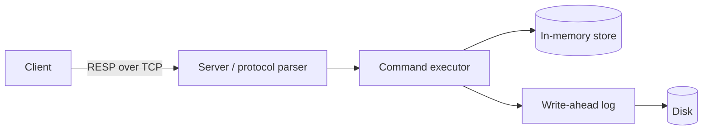

## 1. Goals and non-goals

**Goals** 
- a durable, single-node key-value store speaking a subset of the Redis protocol (RESP).
- acknowledged writes survive a process crash.
- keys can expire (TTL).
- runs core commands PING, ECHO, SET, GET, DEL and EXISTS.
- redis-cli compatibility.
- TCP command server.
- LSM tree storage engine.

**Non-goals** 
- no clustering or replication.
- no SQL, no multi-key transactions.
- no pub/sub.

**Success metrics**
- correctness (all invariants hold under crash tests), throughput and latency targets, recovery time.

---

## 2. Guarantees and failure model

| Failure | What is promised | Under which fsync policy |
|---|---|---|
| Process crash (`kill -9`) | TODO | TODO |
| Power loss / OS crash | TODO | TODO |
| Torn write (half-written record) | TODO | all |
| Disk corruption (flipped bits) | TODO: detected? repaired? | all |
| Disk full | TODO | all |

**Not handled:** TODO (list failures you explicitly do not defend against).

fsync policies offered: `always` / `everysec` / `os` — describe the durability and cost of each.

---

## 3. Interface

**Protocol:** RESP subset. TODO: list the RESP types you parse (simple string, error, integer, bulk string, array).

| Command | Syntax | Reply | Errors |
|---|---|---|---|
| PING | TODO | TODO | TODO |
| SET | TODO | TODO | TODO |
| GET | TODO | TODO | TODO |
| DEL | TODO | TODO | TODO |
| EXPIRE / TTL | TODO | TODO | TODO |

**Limits:** max key size, max value size, max request size, max connections (TODO values; they double as security controls).

---

## 4. Architecture



TODO: describe each component in two sentences. Which component owns which state? What is the concurrency model (single-threaded event loop vs threads) and why?

---

## 5. Paths (step-by-step sequences)

**Write path**
1. TODO: parse → validate → append to log → (fsync per policy) → apply to memory → reply.
2. TODO: what happens if step N fails?

**Read path**
1. TODO

**Recovery path (startup)**
1. TODO: open log → read records → verify checksum → apply → stop at first bad record → truncate → ready.

**Expiry path**
1. TODO: lazy expiry on access + periodic sweep; absolute timestamps.

---

## 6. On-disk formats

**Log record**
```
| length (4B) | crc32 (4B) | type (1B) | payload (length bytes) |
```
TODO: byte order, how SET/DEL/EXPIRE are encoded, version/magic header, how a torn tail is detected.

**SSTable (Stage 3)**
```
| data blocks | index block | bloom filter | footer (offsets + magic) |
```
TODO: block format, sparse index, how tombstones are stored.

**Manifest (Stage 3)**
TODO: list of live SSTables, updated atomically (write temp → fsync → rename → fsync directory).

---

## 7. Invariants (every test comes from one of these)

- I1: TODO e.g. an acknowledged write is present in the log.
- I2: TODO e.g. replaying the log yields exactly the acknowledged operations, in order, or a valid prefix of them after a crash.
- I3: TODO e.g. a key past its absolute expiry is never returned.
- I4: TODO e.g. SSTables are immutable once written.
- I5: TODO e.g. compaction never resurrects a deleted key.

---

## 8. Security and threat model

### 8.1 Assets and trust boundary
- **Assets:** stored data (confidentiality, integrity), service availability, any configured password.
- **Trust boundary:** TODO — default assumption: only trusted clients on localhost or a private network can connect.
- **Attackers considered:** (a) unauthenticated network client, (b) authenticated but malicious client sending malformed or huge input, (c) another local user reading the data directory.
- **Out of scope:** TODO e.g. physical access, a compromised OS, side-channel attacks, nation-state adversaries. Say it plainly.

### 8.2 Controls, mapped to milestones

| # | Control | Build when | Verifying test | Done |
|---|---|---|---|---|
| S1 | Bind to `127.0.0.1` by default; require an explicit flag to listen on other interfaces | Phase 0 / Sun Oct 25 | integration test: default config refuses non-local connections | [ ] |
| S2 | CI runs `bandit` (code issues) and `pip-audit` (vulnerable dependencies) | Phase 0 / Sun Oct 25 | CI job fails on findings | [ ] |
| S3 | Max request size, max key/value size, max connections, idle and read timeouts | Phase 1 / Mon–Tue Oct 26–27 | tests send oversized and stalled requests; server stays up | [ ] |
| S4 | Strict parser: reject malformed frames, never crash; no `pickle` or other unsafe deserialization of client data | Phase 1 / Tue Oct 27 | fuzz test (random bytes, truncated frames) for N minutes with no crash | [ ] |
| S5 | Memory cap (refuse or evict past a limit) | Phase 1 / Tue Oct 27 | test fills memory past the cap; server stays up | [ ] |
| S6 | Optional password `AUTH`: constant-time comparison, rate-limit failures, never log the password | Phase 1 / Tue Oct 27 | unauthenticated commands are rejected; wrong passwords are throttled | [ ] |
| S7 | Data directory and log files created with owner-only permissions (0700 / 0600) | Phase 2 / Thu Oct 29 | test checks file modes | [ ] |
| S8 | Logs never contain passwords or values; keys redacted or truncated if sensitive | Phase 2 / Thu Oct 29 | test greps logs after an AUTH attempt | [ ] |
| S9 | Optional TLS via Python `ssl`; plaintext refused when TLS is enabled | Phase 2 or later / Thu Oct 29 (stretch) | test: plaintext client rejected | [ ] |
| S10 | Integrity note: CRC32 detects accidental corruption only. If tamper-evidence is wanted, use an HMAC with a secret key | Decide in Phase 2; document either way | doc statement + test if HMAC added | [ ] |

Estimated total: about 3 hours across the schedule above.

### 8.3 Residual risks (write these honestly)
- TODO e.g. no encryption at rest; anyone with disk access can read the data.
- TODO e.g. AUTH password sent in plaintext unless TLS is enabled.
- TODO e.g. a single unauthenticated client on an allowed interface can still consume CPU.

### 8.4 Pre-release security checklist
- [ ] Walk the OWASP Top 10 and note which items apply to a network service (injection via the protocol, broken access control, insecure configuration, vulnerable dependencies).
- [ ] No secrets in git history (`.env`, keys, passwords).
- [ ] Run the fuzz test again after the last parser change.
- [ ] README states the threat model and "not for the public internet" clearly.

---

## 9. Decision log

| Decision | Options considered | Chosen | Why | Date |
|---|---|---|---|---|
| Language | Python / Go / Rust | TODO | TODO | Oct 25 |
| Concurrency model | asyncio event loop / threads | TODO | TODO | TODO |
| Persistence design | AOF-style log / Bitcask-style / LSM tree | TODO | TODO | TODO |
| Checksum | CRC32 / HMAC | TODO | TODO | TODO |
| Storage engine (Stage 3) | LSM-lite / B-tree / Bitcask | TODO | TODO | TODO |

---

## 10. Test plan (derived from the invariants)

| Test | Invariant | Method | Status |
|---|---|---|---|
| Model-based: random commands vs a plain Python `dict` | I1–I3 | `hypothesis` stateful testing | [ ] |
| Crash: `kill -9` during writes, restart, compare | I1, I2 | subprocess + signal | [ ] |
| Truncate the log at every byte offset, recover each | I2 | loop over offsets, assert valid prefix | [ ] |
| Concurrency: many clients, no lost updates | I1 | multi-client script | [ ] |
| Protocol fuzz | S4 | random and truncated frames | [ ] |
| Compaction never resurrects deleted keys | I5 | Stage 3 property test | [ ] |

---

## 11. Benchmark plan

- **Workloads:** TODO (SET-only, GET-only, mixed 80/20, with and without expiry).
- **Compare against:** Redis (`redis-benchmark`) and SQLite on the same workload.
- **Fairness rule:** match fsync settings across systems or the comparison is meaningless.
- **Report:** throughput, p50 and p99 latency, recovery time, and where you lose and why.

| System | fsync policy | Ops/sec | p50 | p99 |
|---|---|---|---|---|
| tinykv | always | | | |
| tinykv | everysec | | | |
| Redis | matching | | | |
| SQLite | matching | | | |

---

## 12. Milestones and definition of done

| Phase | Dates | Output | Done when |
|---|---|---|---|
| 0: Design | Sun Oct 25 | This doc, repo, CI | all TODOs in sections 1–8 resolved or consciously deferred |
| 1: In-memory server | Oct 26–27 | RESP server with TTL, S1–S6 | model-based and fuzz tests pass; works with `redis-cli` |
| 2: Durable log | Oct 28–29 | write-ahead log, S7–S10 | truncation and `kill -9` tests pass; 5-minute aloud explanation without notes |
| Benchmarks + demo | Oct 30–31 | benchmark table, demo video | numbers recorded; demo uploaded |
| 3: LSM engine | Nov 7, 14, 21, 28 | memtable, SSTables, manifest, compaction, Bloom filter | compaction and crash tests pass |
| Final write-up | Dec 5 | README, blog post | threat model and limitations stated |

---

## 13. Known limitations and future work

- TODO: be specific. "What I would do next" reads as maturity.